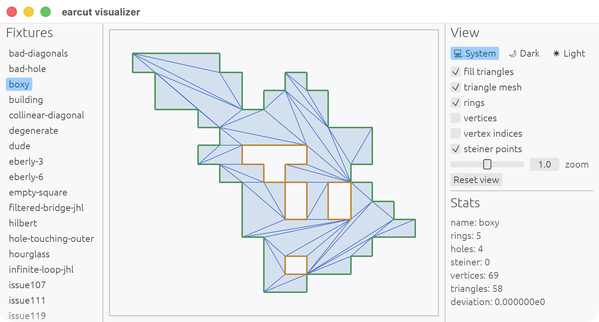

# earcut (Rust)

[](https://github.com/georust/earcut/actions/workflows/ci.yml)
[](https://codecov.io/gh/georust/earcut)
[](https://crates.io/crates/earcut)

A Rust port of the [mapbox/earcut](https://github.com/mapbox/earcut) polygon triangulation library.

- Tracks the triangulation behavior and optional Delaunay refinement from the latest earcut 3.2.4.
- Designed to avoid unnecessary memory allocations. Internal buffers and the output index vector can be reused across multiple triangulations.
- Also provides `earcut::int::EarcutI32` for integer coordinates with exact integer predicates, but it can be slower than the float-based `Earcut` on modern CPUs.
- An additional helper, `utils3d::project3d_to_2d`, projects coplanar 3D polygons onto a 2D plane for use with earcut.

<p align="center">

</p>


## Benchmarks

Time per iteration (smaller is better). Measured on a MacBook Pro (M4 Pro).

| Polygon | earcut.hpp (C++) | earcut (Rust f64) |
|---------|-----------------:|------------------:|
| bad_hole | 1.60 µs | 1.21 µs |
| building | 189 ns | 95.5 ns |
| degenerate | 93.9 ns | 23.8 ns |
| dude | 3.09 µs | 2.82 µs |
| empty_square | 188 ns | 40.9 ns |
| water | 135 µs | 138 µs |
| water2 | 108 µs | 102 µs |
| water3 | 8.73 µs | 7.29 µs |
| water3b | 843 ns | 543 ns |
| water4 | 34.4 µs | 36.9 µs |
| water_huge | 834 µs | 594 µs |
| water_huge2 | 1.80 ms | 1.25 ms |
| water_huge3 | 18.1 ms | 10.8 ms |
| MVT corpus | 212 ms | 175 ms |

Public APIs: Rust reuses buffers; C++ allocates per call.

## Demo

A simple egui-based visualizer for inspecting how earcut works.

```bash
cargo run --example visualizer
```

<p align="center">

</p>

## License

Licensed under either the MIT License ([LICENSE-MIT](./LICENSE-MIT)) or the Apache License 2.0 ([LICENSE-APACHE](./LICENSE-APACHE)) at your option.

This project contains portions derived from [mapbox/earcut](https://github.com/mapbox/earcut), originally distributed under the ISC License ([LICENSE-ISC](./LICENSE-ISC)).
